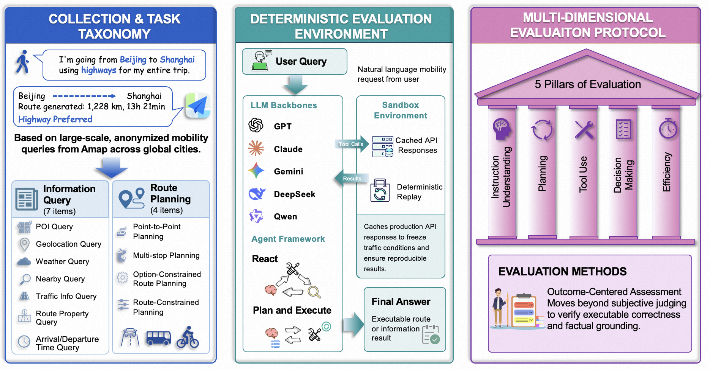
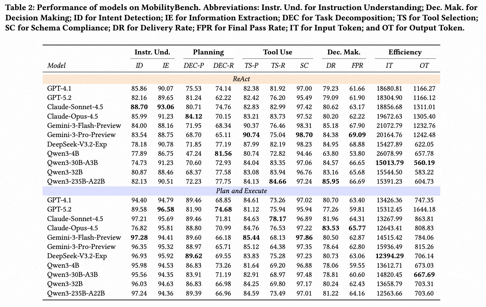

# MobilityBench: A Benchmark for Evaluating Route-Planning Agents in Real-World Mobility Scenarios

<div align="center">

**Zhiheng Song¹, Jingshuai Zhang¹, Chuan Qin†, Chao Wang, Chao Chen, Longfei Xu, Kaikui Liu, Xiangxiang Chu, Hengshu Zhu†**

AMAP, Alibaba Group

¹Equal contribution &nbsp;&nbsp; †Corresponding authors

[](https://arxiv.org/abs/2602.22638)
[](https://huggingface.co/datasets/GD-ML/MobilityBench/tree/main)

**Accepted at KDD 2026 (Oral)**

</div>


## 📖 Overview

**MobilityBench** is a scalable benchmark for evaluating LLM-based route-planning agents in real-world mobility scenarios. It is built from large-scale, anonymized user queries collected from **Amap**, covering a wide range of route-planning intents across **multiple cities worldwide**.

To support **reproducible end-to-end evaluation**, MobilityBench includes a **deterministic API-replay sandbox** that removes environmental variance from live services. It also introduce a **multi-dimensional evaluation protocol** centered on **outcome validity**, complemented by evaluations of **instruction understanding**, **planning**, **tool use**, and **efficiency**. 


*Figure 1: Overview of MobilityBench, a systematic benchmark for evaluating route-planning agents.*


## 📂 Dataset
**MobilityBench** is a scalable benchmark for evaluating route-planning agents in real-world mobility scenarios. It is built from large-scale, anonymized mobility queries from **Amap**, organized with a comprehensive task taxonomy, and provides **structured ground truth** (required tool calls + verifiable evidence). All tool calls are executed in a **deterministic replay sandbox** for reproducible, multi-dimensional evaluation.

**Scale & Coverage:** 100,000 episodes across **22** countries and **350+** cities (including metropolitan areas), with a **long-tailed** geographic distribution.

### Scenario Distribution (11 intents)
- **36.6%** Basic Information Retrieval
- **9.6%** Route-Dependent Information Retrieval
- **42.5%** Basic Route Planning
- **11.3%** Preference-Constrained Route Planning

**Download:** [HuggingFace - MobilityBench](https://huggingface.co/datasets/GD-ML/MobilityBench/tree/main) -> place files into `data/`

#### Data Format

| Field | Description |
|-------|-------------|
| `query` | User query text |
| `context` | Context information (JSON, e.g., current location, city) |
| `task_scenario` | Fine-grained task category |
| `intent_family` | Coarse-grained intent category for evaluation aggregation |
| `tool_list` | Expected tool calls (JSON array) |
| `route_ans` | Ground truth route answer (JSON) |

#### Sample Data (5 Examples)


| Query | Task Scenario | Intent Family |
|-------|---------------|---------------|
| 去大石桥不走高速<br>Go to Dashiqiao without taking the highway. | Option-Constrained Route Planning | Preference-Constrained Route Planning |
| 现在成都大道会堵车吗？看一下地图，会不会堵<br>Is Chengdu Avenue congested now? Looking at the map, is it likely to be congested? | Traffic Info Query | Basic Route Planning |
| 我在哪<br>Where am I? | Geolocation Query | Basic Information Retrieval |
| 知道离滇池会展中心有多远<br>How far it is from Dianchi Convention and Exhibition Center? | Route Property Query | Route-Dependent Information Retrieval |
| 到寨河收费站入口不走高速<br>To reach the Zhaihe toll station entrance without taking the highway. | Option-Constrained Route Planning | Preference-Constrained Route Planning |
## 🚀 Getting Started

### 1. Install

**Requirements:** Python 3.12+, [uv](https://docs.astral.sh/uv/) (recommended) or pip

```bash
git clone https://github.com/your-org/mobility-bench.git
cd MobilityBench-main

# Install with uv (recommended)
uv sync

# Or install with pip
pip install -e .

# With evaluation dependencies
uv sync --extra eval
```

### 2. Configure Environment

Create a `.env` file with your LLM API credentials:

```bash
LLM_BASE_URL=https://api.openai.com/v1
LLM_API_KEY=your-api-key
```

### 3. Download Dataset

> **Note:** Before running, download the dataset from [HuggingFace](https://huggingface.co/datasets/GD-ML/MobilityBench/tree/main) and place the files into `data/datasets/`.

### 4. Run Benchmark

```bash
# Run benchmark with default settings (plan_and_execute framework)
mbench run --model gpt4.1 --dataset data/datasets/sample_10.csv

# Run with ReAct framework
mbench run --model gpt4.1 --framework react

# Run an external CLI harness as the agent-under-test
mbench run --model qwen3-4b --framework claude_code
mbench run --model qwen3-4b --framework codex
mbench run --model qwen3-4b --framework dsh
mbench run --model qwen3-4b --framework dsh_mini
mbench run --model qwen3-4b --framework mini_swe

# Run multiple models in parallel
mbench run --models gpt4.1,claude-opus-4-5 --parallel 4

# Enable sandbox mode (offline evaluation)
mbench run --model gpt4.1 --sandbox

# Resume an interrupted run
mbench run --model gpt4.1 --resume run_20260215_120000
```

### 5. Evaluate Results

```bash
# Evaluate a single run
mbench eval --run-id run_20260215_120000

# Evaluate with specific metrics
mbench eval --run-id run_20260215_120000 --metrics tool,answer,planning
```

### 6. Generate Reports

```bash
# Generate report (markdown / html / excel)
mbench report --run-id run_20260215_120000 --format excel

# Compare multiple runs
mbench report --run-id run_001 --compare run_002
```

## 💻 CLI Commands

| Command | Description |
|---------|-------------|
| `mbench run` | Run agent benchmark on dataset |
| `mbench eval` | Evaluate agent run results |
| `mbench report` | Generate evaluation reports |
| `mbench config` | Manage configuration files |
| `mbench version` | Show version information |

### Run Command Options

| Option | Description | Default |
|--------|-------------|---------|
| `--model, -m` | Model name to use | - |
| `--models` | Multiple models (comma-separated) | - |
| `--dataset, -d` | Dataset name or path | `mobility_6262` |
| `--framework, -f` | Agent framework: `plan_and_execute`, `react`, `codex`, `claude_code`, `dsh`, `dsh_mini`, `mini_swe` | `plan_and_execute` |
| `--config, -c` | Configuration file path | - |
| `--output-dir, -o` | Output directory | - |
| `--parallel, -p` | Parallelism level | `1` |
| `--sandbox/--live` | Use sandbox or live tools | `--sandbox` |
| `--resume` | Resume from run ID | - |
| `--dry-run` | Validate config only | `false` |

### Examples

```bash
# Show all available options
mbench --help
mbench run --help

# Run with custom configuration
mbench run --config configs/models/default.yaml --model qwen3-235b

# Initialize configuration templates
mbench config init --template full

# Validate configuration
mbench config validate --config configs/models/default.yaml
```

## ⚙️ Configuration

### Model Configuration

```yaml
# configs/models/default.yaml
models:
  gpt4.1:
    provider: openai
    base_url: ${LLM_BASE_URL}
    api_key: ${LLM_API_KEY}
    temperature: 0.1
    max_tokens: 8192
    roles:
      planner: gpt-41-0414-global
      worker: gpt-41-0414-global
      reporter: gpt-41-0414-global
```

### Environment Variables

| Variable | Description |
|----------|-------------|
| `LLM_BASE_URL` | Base URL for LLM API |
| `LLM_API_KEY` | API key for authentication |

## 📁 Project Structure

```
mobility-bench/
├── configs/                        # YAML configuration files
│   ├── agent/                      # Agent behavior settings
│   ├── datasets/                   # Dataset configuration
│   ├── evaluation/                 # Evaluation settings
│   ├── harness/                    # External CLI harness launch parameters
│   └── models/                     # Model provider configs
├── data/
│   ├── datasets/                   # Benchmark datasets
│   ├── sandbox/                    # Cached API responses for replay
│   └── results/                    # Run outputs & evaluation results
├── mcp_server/                     # MCP sandbox server + bash CLI bridge
├── src/mobility_bench/
│   ├── cli/                        # CLI commands (run / eval / report / config)
│   ├── agent/                      # Agent implementation
│   │   ├── graph/                  # LangGraph state & builder
│   │   ├── roles/                  # LLM manager & agent factory
│   │   ├── frameworks/             # In-process graphs + external CLI harnesses
│   │   └── prompts/                # Prompt templates (CN & EN)
│   ├── tools/                      # Tool registry & sandbox implementations
│   ├── evaluation/                 # Evaluation engine & 5 metric modules
│   ├── dataset/                    # Dataset schema & loader
│   ├── runner/                     # Batch execution (sequential & parallel)
│   ├── reporting/                  # Report generators (MD / HTML / Excel)
│   ├── config/                     # Configuration management
│   └── utils/                      # Shared utilities
├── pyproject.toml
└── uv.lock
```

## 🤖 Supported Models

| Model | Provider |
|-------|----------|
| GPT-5.2 | OpenAI |
| GPT-4.1 | OpenAI |
| Claude-Opus-4.5 | Anthropic |
| Claude-Sonnet-4.5 | Anthropic |
| Gemini-3-Flash-Preview | Google |
| Gemini-3-Pro-Preview | Google |
| DeepSeek-V3.2-Exp | DeepSeek |
| DeepSeek-R1 | DeepSeek |
| Qwen3-4B | Alibaba |
| Qwen3-30B-A3B | Alibaba |
| Qwen3-32B | Alibaba |
| Qwen3-235B-A22B | Alibaba |

## 🏗️ Supported Architecture

MobilityBench supports two in-process agent frameworks (LangGraph graphs) plus a
family of **external CLI harnesses** driven as the agent-under-test, mirroring
the paper *Finding the Right Fit: Model–Harness Interactions across Agent Tasks*.

### Plan-and-Execute Framework (Default)

A **Planner-Worker-Reporter** architecture for structured task execution:

```
┌─────────────┐     ┌─────────────┐     ┌─────────────┐
│   Planner   │────▶│   Worker    │────▶│  Reporter   │
│  (Planning) │◀────│ (Execution) │     │  (Summary)  │
└─────────────┘     └─────────────┘     └─────────────┘
       │                   │                   │
       └───────────────────┴───────────────────┘
                           │
                    ┌──────┴──────┐
                    │  Tool Call  │
                    │ (Map APIs)  │
                    └─────────────┘
```

- **Planner**: Analyzes user requirements, creates structured plans, dynamically adjusts based on results
- **Worker**: Executes tool calls based on the plan, supports parallel task execution
- **Reporter**: Generates comprehensive natural language reports from execution results

### ReAct Framework

A **Reasoning-Action-Observation** loop for iterative problem solving:

```
┌─────────────────────────────────────────────┐
│                                             │
│  ┌──────────┐   ┌───────────┐   ┌─────────┐ │
│  │ Reasoning│──▶│  Action   │──▶│Observat.│ │
│  │ (Think)  │   │(Tool Call)│   │(Result) │ │
│  └──────────┘   └───────────┘   └────┬────┘ │
│       ▲                              │      │
│       └──────────────────────────────┘      │
│                                             │
└─────────────────────────────────────────────┘
```

- **Reasoning**: Analyzes current state and decides next action
- **Action**: Executes tool call or finishes task
- **Observation**: Processes tool results and feeds back to reasoning

### External CLI Harnesses

Instead of re-implementing the agent loop in Python, these frameworks launch a
real third-party coding agent as a subprocess and treat *it* as the agent-under-
test. Each one is a thin adapter over a shared base: it declares how to launch
the CLI, then maps that CLI's transcript onto the common result contract
(`plan_result`, `planner_training_data`, `worker_training_data`, `token_usage`).
The deterministic sandbox tools are exposed to the harness through the same MCP
server used by the in-process frameworks.

| Framework (`--framework`) | CLI | Protocol | Notes |
|---------------------------|-----|----------|-------|
| `codex` | `codex exec` | OpenAI *Responses* | `wire_api: responses`; MCP sandbox |
| `claude_code` | `claude -p` | Anthropic *Messages* | MCP sandbox; output budget capped via `CLAUDE_CODE_MAX_OUTPUT_TOKENS` |
| `dsh` | `dsh --profile headless` | OpenAI *chat* | full harness, sandbox MCP client enabled |
| `dsh_mini` | `dsh --profile headless` | OpenAI *chat* | lightweight arm: same profile, sandbox MCP client disabled |
| `mini_swe` | `mini` (mini-swe-agent) | OpenAI *chat* | single `bash` tool that shells out to the sandbox CLI |

All external harnesses are pointed at the same model endpoint declared in
`configs/models/*.yaml`; no endpoint is hard-coded in an adapter.

#### Harness Configuration

Launch parameters (binary name, protocol, context window, output budget,
timeout, step budget, MCP wiring) live in `configs/harness/default.yaml`, keyed
by framework name. Adapters read their own stanza via `harness_config(<name>)`
and fall back to conservative defaults when a field is absent. Editing this file
changes how a harness is launched without touching any Python.

```yaml
# configs/harness/default.yaml
harnesses:
  codex:
    bin: codex
    protocol: openai
    wire_api: responses
    context_window: 32768
    timeout: 900
    mcp_client: true

  claude_code:
    bin: claude
    protocol: anthropic
    context_window: 32768
    max_output_tokens: 4096   # claude defaults to 32000, which overflows a 32K window
    timeout: 900
    mcp_client: true

  dsh:       { bin: dsh,  protocol: openai, wire_api: chat, profile: headless, mcp_client: true }
  dsh_mini:  { bin: dsh,  protocol: openai, wire_api: chat, profile: headless, mcp_client: false }
  mini_swe:  { bin: mini, protocol: openai, wire_api: chat, mcp_client: false }
```

`CODEX_BIN` / `CLAUDE_BIN` / `DSH_BIN` / `MINI_BIN` environment variables
override the `bin` field when a CLI is not on `PATH`.

## Benchmark Results

*Figure 2: Overall performance.*

## 📚 Citation

If you find our paper and code helpful for your research, please consider starring our repository ⭐ and citing our work ✏️.

```bibtex
@article{song2026mobilitybench,
  title={MobilityBench: A Benchmark for Evaluating Route-Planning Agents in Real-World Mobility Scenarios},
  author={Song, Zhiheng and Zhang, Jingshuai and Qin, Chuan and Wang, Chao and Chen, Chao and Xu, Longfei and Liu, Kaikui and Chu, Xiangxiang and Zhu, Hengshu},
  journal={arXiv preprint arXiv:2602.22638},
  year={2026}
}
